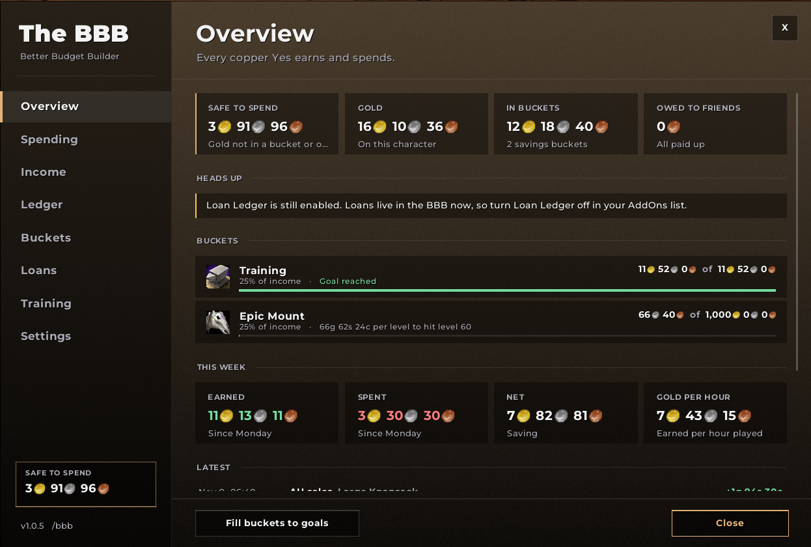
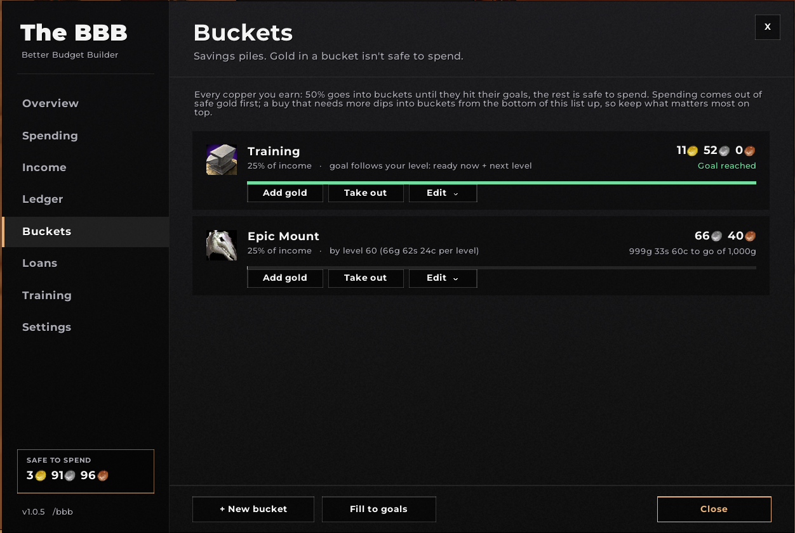
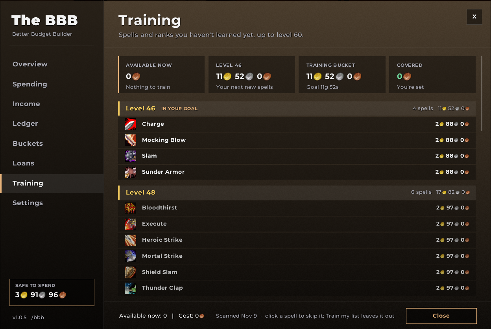
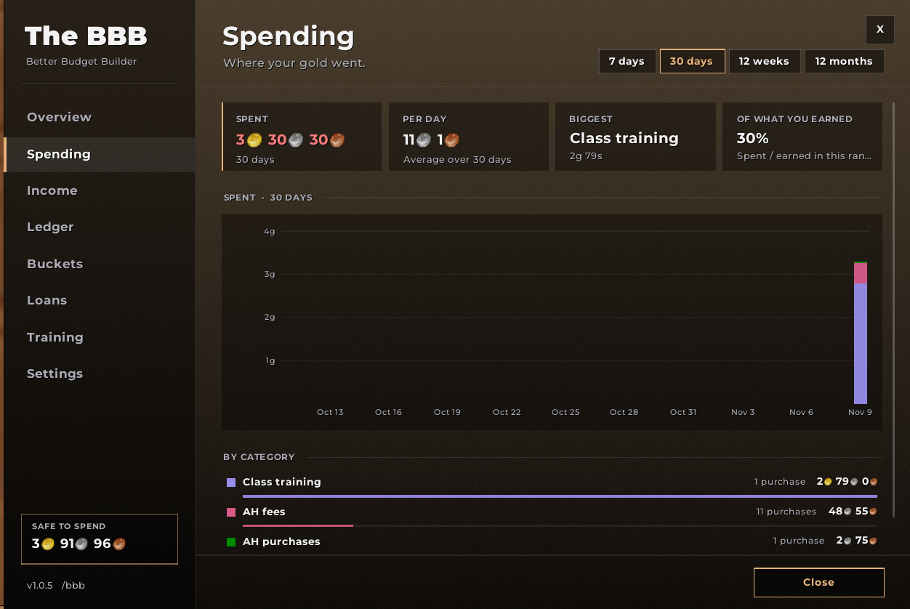
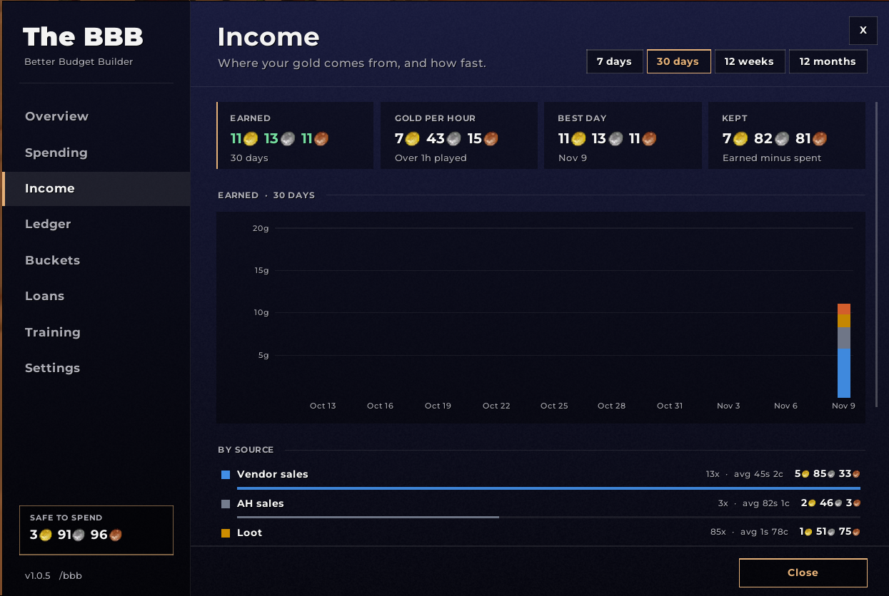
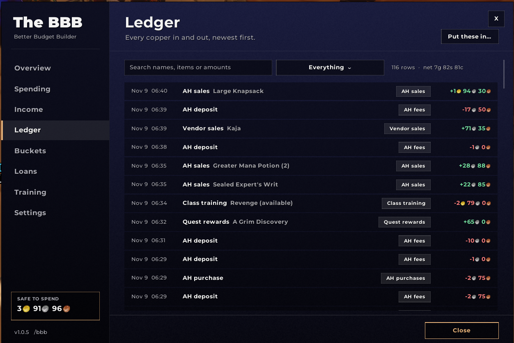
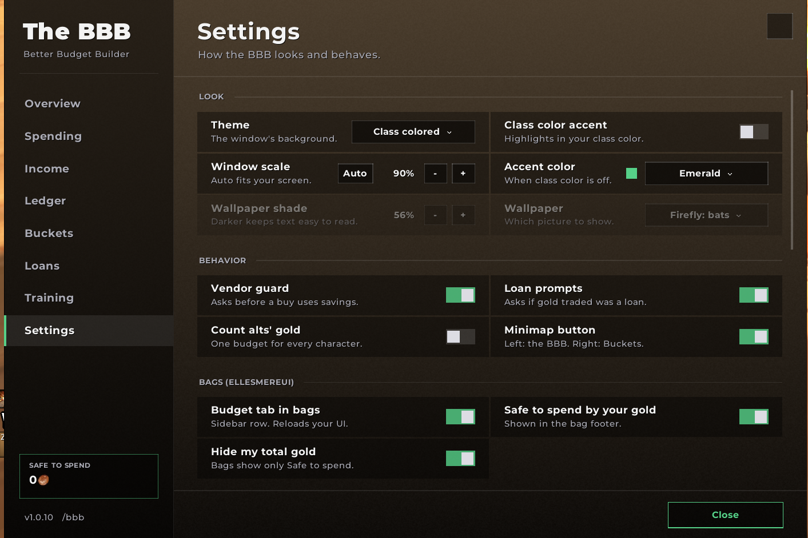
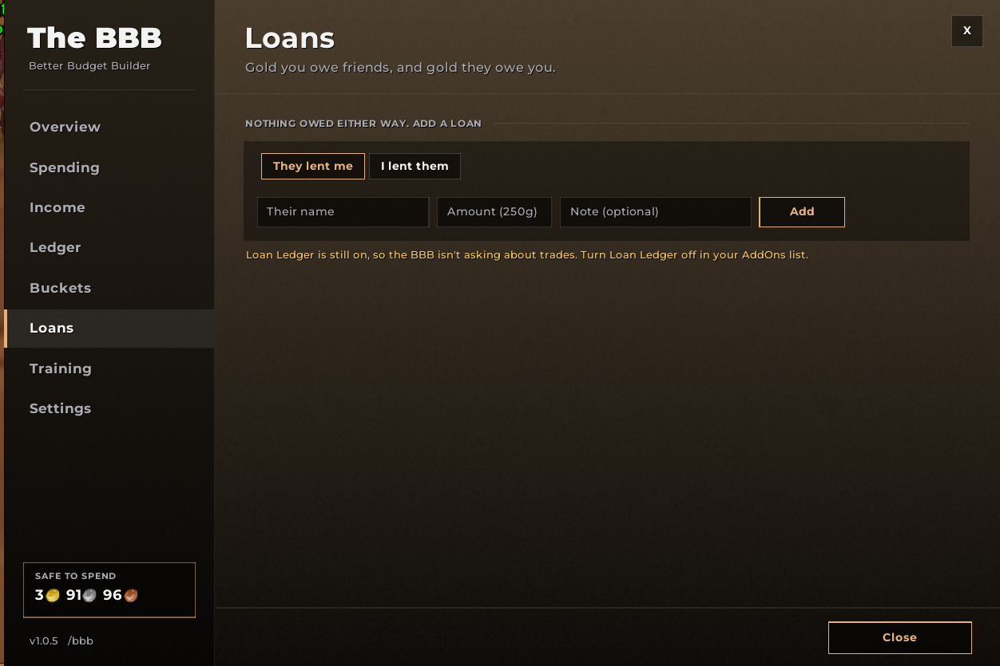
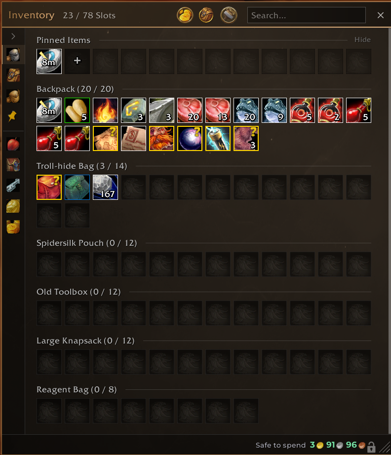

# The BBB (Better Budget Builder)

A gold budget for WoW Classic Forever. It tracks every copper you earn and spend, sorts gold into savings buckets, and asks before a purchase dips into them.

**Works as a plugin for EllesmereUI bags.** Your budget lives right inside your bags. It also runs on its own with the default Blizzard bags.

## Screenshots



**Overview:** Safe to spend, your buckets, this week and the latest gold changes, all on one page.

| | |
|---|---|
|  |  |
| **Buckets:** savings piles with goals and auto-fill | **Training:** your trainer's real prices, grouped by level |
|  |  |
| **Spending:** where your gold went, by category | **Income:** where it comes from, and gold per hour |
|  |  |
| **Ledger:** every copper in and out | **Settings:** themes, the vendor guard, bags and categories |
|  | |
| **Loans:** what you owe and what friends owe you | |

## EllesmereUI bags plugin

When EllesmereUI Bags is loaded, the BBB adds itself to your bag window. It doesn't change any EllesmereUI files.



- **A Budget row in the bag sidebar**, below your categories. Click it to see Safe to spend, your buckets with progress bars, Fill to goals and your open loans, all in the bag's item area. Click any other sidebar entry to return to your items.
- **Safe to spend in the bag footer**, where your gold is shown. By default it hides your total gold, so you only see what's safe to spend. Hover for the full breakdown, or turn your gold back on in Settings → Hide my total gold.
- It shares the sidebar with other plugins that use the same row helper (`EUIBagRows.lua`), and their rows stack neatly.

Without EllesmereUI, Safe to spend shows next to the gold in the Blizzard bags. The `/bbb` window and the minimap button work either way.

## What it does

- **Safe to spend:** your gold minus what's in buckets and what you owe. It shows in the sidebar, on the minimap button, and in the EllesmereUI bag footer, which can hide your total gold.
- **Buckets:** named savings piles with goals, goal levels, auto-fill percentages and icons. Training and Epic Mount (1,000g by 60) come built in.
- **Vendor guard:** a popup before a buy dips into a bucket.
- **Training:** read from your class trainer. Spells are grouped by level with real prices, and you can skip spells you won't train. The Training bucket's goal follows your level. **Train my list** buys everything that's ready except what you skipped.
- **Loans, both ways:** gold friends lent you and gold you lent them. Trades and mail ask whether they were loans, and repayments are matched for you. What you owe isn't safe to spend. Gold you lend isn't counted as spending, and getting it back isn't counted as income. You also get a reminder when that friend comes online.
- **Ledger, Spending and Income:** every gold change, categories with sorting rules, and charts by day, week or month.

Open it with `/bbb`, the minimap button or the Budget row in your bags. `/bbb help` lists the commands.

## Wallpaper theme

The Wallpaper theme shows your own pictures behind the window, with an adjustable shade so text stays readable. You can keep as many as you like and switch between them in Settings.

1. Make a 2048×1024 TGA with your image in the left 1521 px. That part matches the window's shape, and the rest is unused.
2. Save it in `Interface\AddOns\BBB_Wallpaper\`, for example as `Wallpaper.tga`. The folder lives outside the addon so updates never delete it.
3. For more than one picture, add `BBB_Wallpaper.toc` and `List.lua` to that folder:

   ```
   ## Interface: 16001
   ## Title: BBB Wallpaper

   List.lua
   ```

   ```lua
   BBB_WALLPAPERS = {
     { file = "Wallpaper.tga", name = "Sunset" },
     { file = "Wallpaper2.tga", name = "Forest" },
   }
   ```
4. Restart the game, pick Settings → Theme → Wallpaper, then choose a picture under Settings → Wallpaper.

## Development

`tests/logic_test.lua` covers the WoW-free logic in `Logic/`. Run it with LuaJIT from the addon folder:

```
luajit tests/logic_test.lua
```

Releases are made by pushing a `v*` tag. The GitHub Action packages the addon with the BigWigs packager. It uploads to CurseForge once the `CF_API_KEY` secret and `## X-Curse-Project-ID` are set.

Fonts: Montserrat (SIL Open Font License, see `Media/Montserrat-OFL.txt`).
